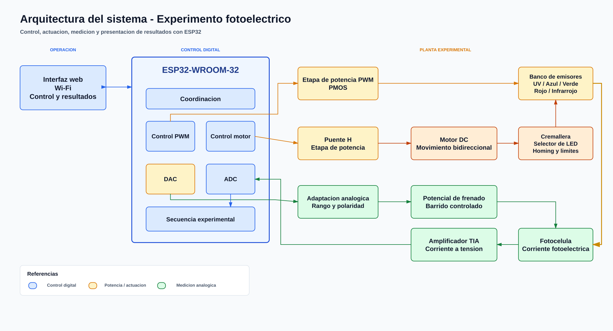

# Firmware ESP32 - Efecto fotoelectrico

## Objetivo del proyecto

Modernizar el experimento de efecto fotoelectrico reemplazando ajustes y lecturas manuales por control y adquisicion automatizados. El ESP32 coordinara la intensidad de los LED, el posicionamiento de los emisores, el potencial de frenado y la medicion de la corriente fotoelectrica.

El objetivo final es ejecutar barridos reproducibles, reducir errores de operacion y presentar los resultados desde una interfaz web para analizar la relacion entre frecuencia, intensidad, corriente y potencial de corte.

## Arquitectura general



[Abrir fuente editable en Excalidraw](docs/arquitectura-sistema.excalidraw).

## Estado del firmware

El firmware esta completo y compila sin advertencias con ESP-IDF 6.0.1. **Todavia no se probo sobre el hardware final**: el protocolo de prueba esta en [docs/pruebas.md](docs/pruebas.md).

| Parte | Modulo | Estado |
| --- | --- | --- |
| PWM de los LED | `led.c` | Escrito; validado en banco con la version anterior |
| Puente H (DIR + PWM) | `motor.c` | Escrito; falta probar en la placa |
| Homing y posicion de cada LED | `cremallera.c` | Escrito; tiempos por calibrar |
| Potencial de frenado (DAC) | `frenado.c` | Escrito; falta medir la salida |
| Medicion de corriente y frenado (ADC) | `medicion.c` | Escrito; falta probar con el amplificador |
| Potencial de corte y constante de Planck | `calculo.c` | Probado en la PC con datos sinteticos |
| Maquina de estados y barrido I-U | `experimento.c` | Escrito |
| Comandos por teclado | `terminal.c` | Escrito |
| Wi-Fi propio y pagina web | `wifi_ap.c`, `servidor_web.c` | Escrito; la pagina se probo con datos simulados |

## Como esta organizado

```text
main/
  config.h           <- todos los pines y parametros (lo unico que deberia hacer falta tocar)
  main.c             <- inicializa todo
  led.c              PWM de la etapa de potencia de los LED
  motor.c            puente H: sentido (DIR) y velocidad (PWM)
  cremallera.c       homing con el sensor optico y movimiento a cada LED
  frenado.c          DAC que genera el potencial de frenado
  medicion.c         ADC: fotocorriente y potencial de frenado aplicado
  calculo.c          potencial de corte, frecuencia y ajuste de h (sin hardware)
  experimento.c      tarea que ejecuta los comandos y hace los barridos
  terminal.c         comandos por teclado desde idf.py monitor
  wifi_ap.c          red Wi-Fi propia
  servidor_web.c     pagina y API REST
  web/index.html     pagina web (se incluye en el binario)
test/
  test_calculo.c     prueba del modulo de calculo en la PC
```

Una sola tarea (`task_experimento`) toca el hardware. El terminal y la pagina web le mandan comandos por una cola de FreeRTOS, asi nunca hay dos partes del programa moviendo el motor o cambiando el DAC al mismo tiempo. El estilo (comentarios Doxygen en los `.h`, `TAG` por modulo, tareas `task_*`, inicializacion con `ESP_LOGI` + `ESP_ERROR_CHECK`) sigue al del [caudalimetro del LSE](https://github.com/utn-fra-lse/caudalimetro).

## Como se mide

1. **Corriente oscura:** LED apagado y frenado en 0 V.
2. **Barrido:** con el LED encendido al 100 % (luz continua), el DAC sube de 0 a 2,5 V en pasos de 25 mV. En cada paso espera 200 ms y promedia 32 lecturas de corriente (GPIO32) y de potencial aplicado (GPIO33).
3. **Potencial de corte U0:** primera tension donde la corriente, menos la oscura, cae debajo del 2 % de la corriente sin frenado. Se interpola entre los dos puntos que cruzan ese umbral. Si la corriente sin frenado es casi nula, el LED se marca "sin fotoemision" (esperable en 850 nm: sirve como control negativo).
4. **Constante de Planck:** ajuste por cuadrados minimos de U0 = (h/e) f - W/e con todos los LED que tienen corte. Con 3 o mas LED se informa la incertidumbre estandar de h a partir de los residuos.

El criterio del 2 % y los demas valores se cambian en `config.h`.

## Conexiones

| Funcion | GPIO | Conector placa | Destino |
| --- | ---: | --- | --- |
| PWM de los LED | 2 | J4 pin 4 (`PWM_POT`) | Etapa IRF540N |
| PWM del motor | 21 | J4 pin 11 (`PWM`) | Puente H |
| Sentido del motor | 19 | J4 pin 10 (`DIR`) | Puente H |
| Sentido invertido | 18 | - | Solo L293D del banco (IN2) |
| Sensor de home | 15 | J4 pin 3 (`home`) | Sensor optico (J2) |
| DAC de frenado | 25 | J3 pin 3 | Amplificador AMPEF4, J2 pin 3 (`DAC_in`) |
| Fotocorriente | 32 | J3 pin 1 | Amplificador AMPEF4, J2 pin 1 (`I_sens x 10`) |
| Frenado aplicado | 33 | J3 pin 2 | Amplificador AMPEF4, J2 pin 2 (`U0`) |

J3 de la placa y J2 del amplificador tienen el mismo orden de pines, asi que el cable va 1 a 1. En el amplificador, el selector SW1 tiene que estar en la posicion DAC.

> **Antes de conectar la placa:** con la placa original, un GPIO en bajo enciende el motor y los LED. El firmware asume la correccion de hardware C1 (segundo inversor). Si la placa no la tiene, poner `LED_PWM_INVERTIDO` y `MOTOR_PWM_INVERTIDO` en 1, sabiendo que el arranque no es seguro.

> **Limites del ADC:** el ESP32 mide de 0 a ~3,1 V. Las salidas del amplificador (TL072 a +/-9 V) pueden superar ese valor o ser negativas, asi que conviene agregar una proteccion (resistencia serie + diodos a 3,3 V y GND) antes de GPIO32 y GPIO33.

## Uso

### Por la pagina web

1. Conectarse a la red Wi-Fi **Fotoelectrico-UTN** (clave `fotoelectrico`).
2. Abrir **http://192.168.4.1**.
3. Usar *Medir todos los LED y calcular h*, o los botones de cada LED. Las curvas, U0 y h aparecen al terminar. *Descargar CSV* baja todas las curvas.

### Por el terminal (`idf.py monitor`)

| Tecla | Accion |
| --- | --- |
| `?` | Ayuda |
| `m` | Medir U e I una vez, y ver el sensor de home |
| `h` | Homing |
| `1`..`5` | Mover la cremallera al LED 1..5 |
| `p` y un numero | Avisar que ese LED se coloco a mano |
| `q` / `w` | Pulso de 200 ms hacia / desde el home (para calibrar) |
| `+` / `-` | Intensidad del LED +/- 10 % |
| `a` / `z` | DAC de frenado +/- 100 mV |
| `c` | Medir la curva I-U del LED en posicion |
| `e` | Experimento completo |
| `r` | Mostrar resultados y curvas en CSV |
| `s` o `ESPACIO` | **Detener todo** |

## Compilar y cargar

Desde una terminal ESP-IDF 6.0.1:

```powershell
idf.py set-target esp32
idf.py build
idf.py -p COM4 flash monitor
```

Prueba del calculo en la PC (no necesita el ESP32):

```bash
cd test
gcc -I../main test_calculo.c ../main/calculo.c -lm -o test_calculo && ./test_calculo
```

## Tecnologias

- **Microcontrolador:** ESP32-WROOM-32 (DevKit V1 de 30 pines).
- **Framework:** ESP-IDF 6.0.1 y FreeRTOS.
- **Lenguaje:** C.
- **Perifericos:** GPIO, LEDC/PWM, DAC, ADC1, Wi-Fi y servidor HTTP.
- **Amplificador:** AMPEF4 del Laboratorio de Fisica Electronica ([utn-fra-lse/efecto-fotoelectrico](https://github.com/utn-fra-lse/efecto-fotoelectrico)).
